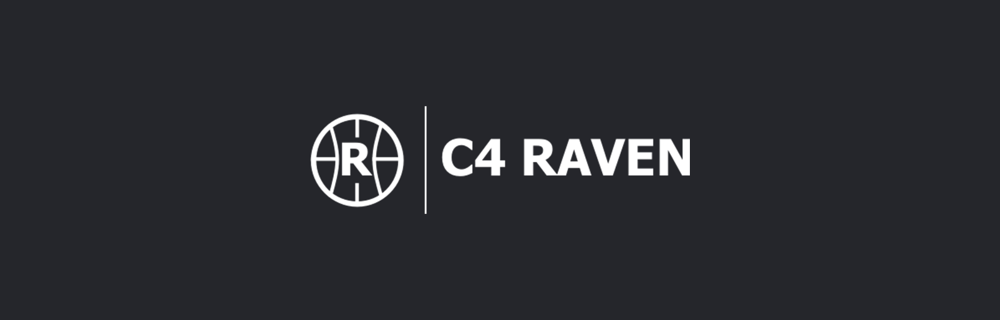

<p align="center">
  
</p>

<p align="center">
  <a href="https://tak.c4raven.net"><strong>tak.c4raven.net</strong></a>
</p>

# C4 Raven server setup

Setup files for a fresh deployment of our TAK (Team Awareness Kit) server —
a Raven-branded, security-hardened
fork of [the upstream project](https://www.opentakserver.io/)
([c4raven-server](https://github.com/C4-Raven/c4raven-server)), paired with
the [C4 Raven UI](https://github.com/C4-Raven/c4raven-ui) frontend.

## Supported platforms

The stack started as Ubuntu/amd64 and is being extended to Rocky/RHEL 9
and to arm64. The table below is what each combination actually is today,
not what we intend it to be:

| Target | `curl \| bash` | `.deb` | `.rpm` | offline bundle |
| --- | --- | --- | --- | --- |
| Ubuntu 24.04 / 25.10, amd64 | supported | supported | n/a | supported |
| Ubuntu 24.04 / 25.10, arm64 | untested | untested | n/a | untested, arm64-built only |
| Rocky / Alma / RHEL 9, x86_64 | untested | n/a | untested | not available |
| Rocky / Alma / RHEL 9, aarch64 | untested | n/a | untested | not available |
| Debian 12 | untested | untested | n/a | not available |

**"Untested" means exactly that.** Everything outside the Ubuntu/amd64
row is static analysis plus archive metadata: the package names, repo
URLs and architectures have been checked against the live archives, and
`tests/run-matrix.sh` runs the cells in containers, but no Rocky and no
arm64 install has been run on real hardware. Treat the first one you do
as a bring-up, not a deployment, and read
[`docs/rocky-el9.md`](docs/rocky-el9.md) and
[`docs/architectures.md`](docs/architectures.md) first.

Three limits that are structural rather than a to-do list:

- **Offline bundles are best built on their own architecture.**
  `build-offline.sh` refuses a cross-build unless `ALLOW_CROSS_BUILD=1`.
  Two locked dependencies (`mutf8` 1.0.6, `unishox2-py3` 1.0.0) publish
  no wheel for Python 3.12/3.13 on any architecture, so every build
  compiles them from sdist. A native build installs and imports the
  result; a cross-build compiles them with zig for the target and checks
  each `.so` is the right architecture, but cannot import them — see
  [`docs/architectures.md`](docs/architectures.md).
- **An EL9 offline payload cannot be built on Ubuntu** for the same
  reason in the other direction: Rocky 9 is glibc 2.34, Ubuntu 24.04 is
  2.39 and 25.10 is 2.42, so wheels compiled on Ubuntu fail at *import*
  on Rocky. `rpm/build-rpm.sh` refuses it. Nothing stages an EL9 offline
  payload today, which is why those cells read "not available" rather
  than "untested".
- **Federation Hub needs a TAK.gov download.** On Ubuntu/Debian either
  the `.deb` or the Docker release works; on Rocky/RHEL 9 only the Docker
  release does. See [Federation Hub](#federation-hub).

## Install

Pick one of four ways in:

| Path | Use it when | Updates with |
| --- | --- | --- |
| [`install.sh`](#option-2-installsh) | a box with internet; tracks `main` | `update.sh` or c4raven-updater |
| [`.deb`](#option-1-deb-package) | Ubuntu with internet; pinned release | a newer `.deb` (or `update.sh`) |
| [`.rpm`](#option-3-rpm-package-rocky--alma--rhel-9) | Rocky / Alma / RHEL 9 | a newer `.rpm` |
| [offline bundle](#offline-no-internet-on-the-server) | no internet on the server at all | a newer bundle |

What changed in each release is in [`CHANGELOG.md`](CHANGELOG.md).

### Offline (no internet on the server)

`build-offline.sh` produces one archive per Ubuntu release and
architecture, `c4raven-server-offline_<version>_<release>_<arch>.tar`.
Pick the one matching the machine, both halves of it: `noble` is Ubuntu
24.04 and `questing` is 25.10, and the architecture suffix is the dpkg
name (`amd64`, `arm64`). A bundle only exists for an architecture
somebody built it for — see [Supported platforms](#supported-platforms).

**What's inside.** One top-level directory with:

- `repo/` — a local apt repository: `c4raven-server_<version>_<arch>.deb`
  plus every Ubuntu package it needs (PostgreSQL, PostGIS, RabbitMQ,
  nginx, ffmpeg, ...), resolved from an empty system so nothing is
  assumed to be installed already.
- `install.sh` — installs from `repo/` only.
- `MANIFEST` — target architecture, build time, and the exact backend and
  UI commits, mediamtx version, plugin file and its SHA-256, Python
  versions and the ATAK icon set inside.
- `SHA256SUMS` — a checksum for every other file in the directory.
- `README.txt` — these instructions, for whoever carries the disk.

The server `.deb` holds the whole application, pinned at build time: the
backend and all its Python dependencies as prebuilt wheels, the built web
UI, mediamtx, the ATAK icon sets (which an online install downloads from
GitHub on first start), and the tak.gov-signed CROW Remote Clear ATAK
plugin. The
plugin is published into the server's plugin repository on install, set to
install on enrollment, so devices get it with no upload through the web
UI. A newer APK uploaded later is never downgraded by a package upgrade.

**Verifying it.** The build writes a `SHA256SUMS` next to the archives
and the `.deb`, covering each of them. Copy it across with them and, in the
directory holding them, check the archive before extracting it:

```
sha256sum -c --ignore-missing SHA256SUMS
```

(`--ignore-missing` skips the archives for other releases you did not
copy.) Inside the archive, `install.sh` runs `sha256sum -c SHA256SUMS` over
its own contents and stops before touching the system if anything is
missing or altered. To check that by hand, or to see what you are about to
install:

```
tar -xf c4raven-server-offline_2.3.0_noble_amd64.tar
cd c4raven-server-offline_2.3.0_noble_amd64
sha256sum -c SHA256SUMS
cat MANIFEST
```

Checksums prove the copy is intact, not who made it: there is no
signature, so get `SHA256SUMS` from the build machine over a channel you
trust.

**Installing with no internet.** Copy the archive across (USB disk,
`scp` on the local network), then on the server:

```
tar -xf c4raven-server-offline_2.3.0_noble_amd64.tar
cd c4raven-server-offline_2.3.0_noble_amd64
sudo ./install.sh
```

`install.sh` refuses to run on the wrong Ubuntu release or architecture.
It then installs through apt with the bundled repository as the only
source for that run, so it never reaches for a mirror and never
downgrades anything already installed. Leave the domain prompt blank and
answer "no" to Turnstile: without internet there is no Let's Encrypt or
Cloudflare, and the server's own CA is used instead. (A domain entered
anyway is used for WebRTC, but no Let's Encrypt request is made; run
`sudo dpkg-reconfigure c4raven-server` once the machine is online.)

Nothing in the install touches the network: apt reads only `repo/`, and
the package installs the backend, UI, mediamtx, icon sets and plugin from
inside itself. As a guard, `install.sh` points HTTP(S) proxies at a closed
local port for the run, so anything that unexpectedly tries to download
fails at once with a message saying so, rather than hanging
(`RAVEN_OFFLINE_GUARD=0` turns that off). CI installs the bundle in a
container started with `--network none`, upgrading from the previous
release's bundle, and runs `tests/verify.sh` (`tests/offline-e2e.sh`).

To upgrade, run `install.sh` from a newer bundle; config, certificates,
database and uploads are kept, the database is migrated to the new schema
on restart (install.sh checks it reached head), and nginx site files
certbot or an admin edited get the X-Ssl-Cert fix patched in place.
Re-running the same bundle reinstalls it, re-running its setup. There is no source checkout to pull, so
this repo's `update.sh` refuses an offline install, and c4raven-updater
applies only its `config.yml` and nginx fixes to one, not new code.

Building it (on a machine with internet):

```
PKG_VERSION=2.3.0 ./build-offline.sh
```

It builds for the machine it runs on. To get an arm64 bundle, run the
same command unchanged on arm64 hardware, an arm64 cloud VM, or
`docker run --platform linux/arm64`; or, on amd64, add
`TARGET_ARCH=arm64 ALLOW_CROSS_BUILD=1`, which cross-compiles the two C
extensions but can only resolve-check, not import-check, the result (see
[Supported platforms](#supported-platforms)). The apt dependencies
come from `archive.ubuntu.com` for amd64 and from `ports.ubuntu.com` for
everything else, which the script picks automatically;
`archive.ubuntu.com` has no `binary-arm64` at all and 404s if you point
it there by hand.

It needs Node.js 20.19+ and a `python3.12` and `python3.13` (on `PATH`, or
via `uv python install 3.12 3.13`). It builds from each repo's `main` tip
unless `SERVER_SHA`/`UI_SHA`/`PLUGIN_APK` say otherwise, refuses a plugin
that isn't signed by the TAK Product Center, and before packaging proves
that the Python wheels install with no index and that each release's
repository resolves `c4raven-server` on its own. Output goes to `build/`
(`BUILD_DIR=...` to put it, and the ~10 GB of scratch, elsewhere). The
server `.deb` it also leaves there (`c4raven-server_<version>_amd64.deb`)
installs
offline on its own too, on a machine that already has the apt
dependencies. See the header of `build-offline.sh` for every option.

### Option 1: `.deb` package

Download the latest `c4raven-server_*_all.deb` from
[Releases](https://github.com/C4-Raven/c4raven-server-setup/releases) and:

```
sudo apt install ./c4raven-server_*_all.deb
```

apt pulls in PostgreSQL, RabbitMQ, nginx, and everything else this needs as
real dependencies, then prompts for the two questions install.sh below
also asks (a public domain, Cloudflare Turnstile) via the standard Debian
config-file prompt, and does the rest of the setup (backend venv,
frontend build, certificate authority, systemd services) in its postinst
script. `sudo apt install ./c4raven-server_*_all.deb` again on a newer
`.deb` to upgrade — each release is pinned to a specific, reproducible
commit of `c4raven-server`/`c4raven-ui` rather than always floating to
`main`.

One prerequisite apt can't satisfy for you: building the frontend needs
Node.js 20.19 or newer, and Ubuntu 24.04's own `nodejs` package is 18.x.
On such a system install Node 22 first (`install.sh` does this itself):

```
curl -fsSL https://deb.nodesource.com/setup_22.x | sudo -E bash -
sudo apt install -y nodejs
```

The package is `Architecture: all` and builds everything on the target,
so the same `.deb` installs on arm64 as on amd64 — every dependency it
declares exists on both in Ubuntu, and NodeSource's `setup_22.x`
publishes both. Untested on arm64 all the same. The offline `.deb` is
the exception: it carries prebuilt binaries, so it is
`Architecture: amd64` or `arm64` and built once per architecture.

`apt remove` stops the services but leaves your data in place; `apt purge`
prints exactly what a full wipe (database, `/opt/raven`, the `raven`
system user) requires rather than doing it automatically — that's too
high-stakes to run unattended.

### Option 2: `install.sh`

One command, on a fresh Ubuntu box:

```
curl -fsSL https://raw.githubusercontent.com/C4-Raven/c4raven-server-setup/master/install.sh | bash
```

This installs everything in one pass: system packages, PostgreSQL,
RabbitMQ, the backend and frontend, nginx, mediamtx, and the systemd
services. It interactively asks whether to enable Cloudflare Turnstile
(the login-page bot check — you'll need a site key and secret key from your
Cloudflare dashboard's Turnstile section) and whether to configure a public
domain (gets you a real Let's Encrypt certificate instead of a self-signed
one). At the end it installs Federation Hub if you have its TAK.gov
download (see [Federation Hub](#federation-hub)). Run as
your own sudo-capable user, not root and not `raven` — it uses `sudo`
itself where needed and prompts for your password on the terminal even
when piped into `bash`. Update later with `update.sh`, which always pulls
the latest `main` rather than a pinned version.

To run it unattended (cloud-init, Ansible, no terminal at all), answer the
questions in the environment instead. A question whose variable is set is
never asked; set one to empty to answer "no":

| Variable | Answers |
| --- | --- |
| `RAVEN_TURNSTILE_ENABLE` | Turnstile on (`true`/`yes`/`1`) or off (anything else) |
| `RAVEN_TURNSTILE_SITE_KEY`, `RAVEN_TURNSTILE_SECRET_KEY` | the Turnstile keys (asked for if Turnstile is on and they are unset) |
| `RAVEN_DOMAIN` | the public domain; empty for none |
| `RAVEN_FEDHUB_ARTIFACT` | path to the Federation Hub `.deb` or Docker `.zip`; empty to skip Federation Hub. Unset: looked for in `~/Downloads` |
| `RAVEN_FEDHUB_DEB` | older name for `RAVEN_FEDHUB_ARTIFACT`; `RAVEN_FEDHUB_DEB=` (empty) still skips Federation Hub |
| `RAVEN_FEDHUB_SKIP` | `1` skips Federation Hub without looking for it |
| `RAVEN_DB_PASSWORD` | the existing `raven` PostgreSQL password, on a re-run that can't find it in `config.yml` or the secrets file |
| `RAVEN_SKIP_SYSTEMD_CHECK` | `1` skips the systemd-as-PID-1 check (see [Running in Docker](#running-in-docker)) |
| `REPO_RAW` | where to fetch the templates and helpers from; `file:///path/to/c4raven-server-setup` uses a local checkout |

```
curl -fsSL https://raw.githubusercontent.com/C4-Raven/c4raven-server-setup/master/install.sh \
  | RAVEN_TURNSTILE_ENABLE=false RAVEN_DOMAIN=tak.example.org RAVEN_FEDHUB_SKIP=1 bash
```

The names match the `.rpm`'s (below). The installer still needs
passwordless `sudo` when there is no terminal to type a password into.

Everything that differs between distributions — package manager and
package names, the nginx layout, PostgreSQL's initdb, firewalld, SELinux
— goes through `lib/distro.sh`, so the same script is meant to run on
Rocky/Alma/RHEL 9 as well. That path is the least exercised of the
three: on EL the `.rpm` below is the better-trodden route, because it is
the one `tests/run-matrix.sh` installs and verifies.

### Option 3: `.rpm` package (Rocky / Alma / RHEL 9)

EL9 needs its repositories set up first — `dnf` has to be able to
resolve `rabbitmq-server` and `certbot` *before* the package is
installed, so this cannot live inside the package:

```
sudo ./rpm/c4raven-el9-repos.sh
sudo dnf install ./c4raven-server-*.el9.*.rpm
```

That enables EPEL 9 and CRB, adds the RabbitMQ repository, and switches
the `nodejs` module stream to 22 (EL9's default is 18, which cannot
build the UI). Build the RPM itself with `PKG_VERSION=2.3.0
./rpm/build-rpm.sh`; it is `noarch` like the `.deb`, builds nothing at
package-build time, and does the whole setup on the target machine from
`/usr/libexec/c4raven-server/configure.sh`.

There is no debconf on RPM, so the two questions the `.deb` asks are
answered in a file instead. Either set them in the environment for an
unattended install:

```
sudo RAVEN_DOMAIN=tak.example.org dnf install ./c4raven-server-*.rpm
```

or install first, then edit `/etc/c4raven-server/setup.conf` and apply
it with `sudo c4raven-setup` — the same code path, idempotent, as many
times as you like. `setup.conf` is `%config(noreplace)` and mode 0600
(the Turnstile secret passes through it, and is blanked out of the file
once it has been consumed).

The practical differences from Ubuntu, all of them things an operator
will notice, are in [`docs/rocky-el9.md`](docs/rocky-el9.md): SELinux and
firewalld are on by default, the nginx layout has no
`sites-available`/`sites-enabled`, PostgreSQL ships uninitialised, the
venv is built with `python3.12` rather than `python3`, PostGIS and the
full `ffmpeg` are not packaged for EL9, and on aarch64 RabbitMQ is
capped at 4.3.2. Federation Hub works on EL only from its Docker release
(see [Federation Hub](#federation-hub)).

At the end, every option makes sure the first administrator account has
to set a real password on first login (see [`seed_admin.py`](#files)
below) and prints the URL to log in at.

### If the install fails the first time

`install.sh` stops at the first step that fails, prints which step it
was, and says how to resume. Fix the cause it printed (most often a
network blip, or a machine short of the roughly 2 GB of memory the UI
build needs) and **run the same command again**. A re-run resumes: it
keeps the database and its users, the certificate authority and server
certificate, `config.yml`, `mediamtx.yml`, the source checkouts and the
secrets file. It reuses the database password from the previous run
(from `config.yml` or `/opt/raven/.raven-secrets.env`; `RAVEN_DB_PASSWORD`
supplies it if neither has one) and the domain answer it saved in
`/opt/raven/.install-answers`. Network steps are retried with backoff
before they count as a failure.

At the end, `install.sh` checks the services, the database migrations and
a live API request, prints a PASS/FAIL summary, and exits non-zero if
anything failed.

If the web UI comes up but nobody can log in, or `raven.service` is
missing, use the recovery tools in
[c4raven-updater](https://github.com/C4-Raven/c4raven-updater), as your
own sudo-capable user:

```
git clone https://github.com/C4-Raven/c4raven-updater.git
cd c4raven-updater
./diagnose-login.sh      # says what is wrong; changes nothing
./finish-install.sh      # repairs what is missing
```

`diagnose-login.sh` prints service states, code versions, whether the
schema is at the latest migration, the login settings (no secrets), each
account's flags, a scripted login straight to the backend and through
nginx, the nginx sites and certificates, and recent errors. It tests
`administrator` / `password` unless you set `LOGIN_USER` and
`LOGIN_PASS`.

`finish-install.sh` walks the install in order and repairs only what is
missing or broken: backend, `config.yml`, the PostgreSQL role and
database, migrations, the CA, mediamtx, the nginx sites, the web UI,
RabbitMQ, the secrets file, the systemd units, and finally an
`administrator` login test. It never drops the database and never
regenerates an existing CA, `config.yml` or nginx site. The updater's
`update.sh` runs it by itself when it finds an install that never
finished.

### Running in Docker

The stack is a set of systemd services (PostgreSQL, RabbitMQ, nginx,
mediamtx and the five Raven units), so the container has to run systemd
as PID 1. There is no single-process image. Start from an image whose
`CMD` is `/sbin/init` and give it what systemd needs. The test matrix
uses these images, in [`tests/images/`](tests/images):

- `Dockerfile.ubuntu-24.04` — `ubuntu:24.04` plus `systemd`, `dbus`,
  `sudo`, `curl`, `tzdata`; removes `/usr/sbin/policy-rc.d` (otherwise
  package installs never start their services); masks the udev, getty and
  kernel-mount units a container cannot run; `STOPSIGNAL SIGRTMIN+3`.
- `Dockerfile.rocky-9` — `rockylinux:9-ubi-init` with the same masks.

Both add an ordinary sudo-capable user, `tester`, because `install.sh`
refuses to run as root. Build and start one the way
[`tests/lib/common.sh`](tests/lib/common.sh) does:

```
docker build -t c4raven-ubuntu -f tests/images/Dockerfile.ubuntu-24.04 tests/images
docker run --detach --name raven \
  --privileged --cgroupns=host \
  --tmpfs /run --tmpfs /run/lock \
  --volume /sys/fs/cgroup:/sys/fs/cgroup:rw \
  --hostname raven \
  -p 80:80 -p 443:443 -p 8080:8080 -p 8443:8443 -p 8446:8446 \
  -p 8087:8087/udp -p 8088:8088 -p 8089:8089 \
  c4raven-ubuntu
docker exec -it -u tester raven bash -lc \
  'curl -fsSL https://raw.githubusercontent.com/C4-Raven/c4raven-server-setup/master/install.sh | bash'
```

All of `--privileged --cgroupns=host --tmpfs /run --tmpfs /run/lock
--volume /sys/fs/cgroup:/sys/fs/cgroup:rw` are needed. Leaving one out
does not fail loudly: systemd boots degraded and half the units never
start, which looks like an install bug. With podman, add
`--systemd=always`. Inside such a container every install path runs
unchanged; `tests/run-matrix.sh` installs and verifies each one this way.
To try an offline install, `docker cp` the bundle in and run it with no
network.

The `-p` list covers the web UI (80/443), VPN onboarding (8080), the
EUD ports (8087/udp, 8088 TCP, 8089 SSL), the Marti API (8443) and
enrollment (8446). For video add 8322 (RTSPS), 1936 (RTMPS), 8554 (RTSP),
1935 (RTMP), 8189/udp (WebRTC) and 8890/udp (SRT), and 8883 for MQTTS:
the same list `install.sh` opens in the firewall. Data lives in the
container, so `docker rm` deletes it: back it up (c4raven-updater's
`update.sh` writes a backup on each run) or keep the container.

`install.sh`, the `.deb`, the `.rpm` and the offline `install.sh` all
check for systemd as PID 1 before changing anything, and stop with the
flags above if it is missing; `RAVEN_SKIP_SYSTEMD_CHECK=1` skips the
check. c4raven-updater can run as root in a container (which often has no
other account); without systemd it still updates code, migrations, config
and nginx files, skips the restarts and lists what to restart yourself.

### Federation Hub

TAK Federation Hub connects this server to other TAK servers. It is
licensed software, so no installer here can download it for you. Get it
from your TAK.gov account in either form:

- **`takserver-fed-hub_<version>_all.deb`** — Ubuntu/Debian only.
- **the Federation Hub Docker release** (a `.zip` with `fed`, `hub` and
  `docker` in its name) — Ubuntu/Debian or Rocky/Alma/RHEL 9.

Put the file in `~/Downloads` (a subfolder is fine) of the user who runs
the installer **before** running `install.sh`. Its last step finds the
file and installs Federation Hub with
[c4raven-updater](https://github.com/C4-Raven/c4raven-updater)'s
`install-fedhub.sh`: MongoDB, its certificates and config,
the systemd service, the firewall ports, and the Raven side
(`config.yml`, certificates and `fedhub_bridge.service`). If no file is
found, it asks for the path. Press Enter to skip, or type `never` to stop
being asked. Unattended runs use `RAVEN_FEDHUB_ARTIFACT=/path/to/file`, or
`RAVEN_FEDHUB_SKIP=1` to skip it (see the variables table above).

Federation Hub never fails the main install. If its step fails or is
skipped, the install carries on, says so at the end, and prints the
commands below. Ctrl-C at one of its prompts skips just that step; the
rest of the install still runs.

`install.sh` keeps c4raven-updater in `~/c4raven-updater` and updates it
with `git pull --ff-only`. It never discards anything there. If the pull
fails (no network, local changes, a diverged branch), it warns and uses the
copy as it is, or, if that copy has no `install-fedhub.sh`, prints how to
move it aside and clone a fresh one. If `~/c4raven-updater` is not a git
checkout at all, it is left alone and the clone goes to
`~/c4raven-updater.clone` instead.

Re-running `install.sh` keeps the host name Federation Hub was set up with,
even if you give a different domain this time. To change the hub's host,
run `./install-fedhub.sh --host NEW_NAME` from c4raven-updater.

#### If the Federation Hub step failed or was skipped

Download the file from TAK.gov into `~/Downloads`, then, as your own
sudo-capable user (not root, not `raven`):

```
git clone https://github.com/C4-Raven/c4raven-updater.git ~/c4raven-updater   # or: cd ~/c4raven-updater && git pull
cd ~/c4raven-updater && ./install-fedhub.sh            # finds the file in ~/Downloads, or asks for its path
./install-fedhub.sh --artifact "/path/to/takserver-fed-hub_X_all.deb"   # or the docker .zip
```

It is safe to run again. `./install-fedhub.sh --check` changes nothing; it
exits 0 when Federation Hub is installed and wired into Raven, 3 when it
is not installed and 4 when it is installed but Raven is not wired to it.
c4raven-updater's `./update.sh` and `./finish-install.sh` also check for
Federation Hub and offer to install it.

The `.deb`, the `.rpm` and the offline bundle do not install Federation
Hub. They point at these same steps. Their package scripts run as root,
but run the steps as your normal sudo-capable user. When `install.sh`
cannot download c4raven-updater, it uses an existing checkout in
`~/c4raven-updater` if there is one. On a server with no internet
(including the offline `.deb`), skip the `git clone`: copy a
c4raven-updater checkout from a connected machine into `~/c4raven-updater`
along with the TAK.gov file. Its dependencies, such as MongoDB, may still
need a package mirror.

## Connecting ATAK, iTAK and WinTAK

Clients enroll for their certificate on port **8446**. That port serves two
certificates, depending on how the client reaches the server:

- **Users who can reach the public domain** (only when you gave the
  installer a domain and certbot succeeded): in ATAK use **Quick Connect**
  and type the domain, e.g. `tak.example.org`, plus their username and
  password. 8446 shows them the Let's Encrypt certificate for that domain,
  which ATAK already trusts. Quick Connect only works with the domain name.
  It does not work with an IP address.
- **VPN and bare-IP users** (no domain, or the server is reached by its
  IP address over a VPN): log in to the web UI and scan the **Connect over
  VPN** QR code with ATAK. It downloads a small connection package over
  plain HTTP on port 8080. The package contains the server's own CA
  certificate and enrolls with that CA as the only one ATAK trusts for this
  server, so the IP address needs no publicly trusted certificate. On
  iTAK, download the connection package from the same page and import it
  with **Upload Server Package**. On WinTAK, import it as a data package.

Behind the scenes, 8446's default server (`raven_certificate_enrollment`)
always presents Raven's internal-CA certificate, and that is what any
client that doesn't ask for the domain by name gets. An IP-address TLS
connection sends no SNI. When a Let's Encrypt certificate exists, the
installers add a second block, `raven_certificate_enrollment_domain`
(`server_name <your domain>`), that presents it. They re-create it on
every run, after certbot. Renewals are picked up by an nginx reload from
certbot's nginx installer and from
`/etc/letsencrypt/renewal-hooks/deploy/raven-nginx-reload`. Keep ports 8080
and 8446 open. All three install paths open both.

## Update

For a server installed with `install.sh` (or the `.deb`, if you'd rather
track `main` than wait for the next release), one command, run as your own
sudo-capable user (not root, not `raven`):

```
curl -fsSL https://raw.githubusercontent.com/C4-Raven/c4raven-server-setup/master/update.sh | bash
```

Pulls the latest `main` of `c4raven-server` and `c4raven-ui`, reinstalls
the backend (`poetry install`), rebuilds the frontend with `yarn` and
deploys it to the webroot, then restarts the services (`raven`,
`cot_parser`, `eud_handler`, `eud_handler_ssl`, `mediamtx`, and
`federation-hub` if it's running) — you'll be asked for your `sudo`
password on the terminal as needed. Database migrations happen
automatically when `raven` restarts — there's no separate migration step
to run. It also adds `proxy_set_header X-Ssl-Cert "";` to the existing
nginx sites that don't verify client certificates (backing each file up
first and restoring it if `nginx -t` fails). Never touches your
`config.yml` or data — safe to run any time.

An RPM install is upgraded the same way the `.deb` is — `sudo dnf
install ./c4raven-server-<newer>.rpm`, which re-runs `configure.sh` and
checks out the commit that version pins. `update.sh` itself is
distro-agnostic (it pulls, rebuilds and restarts; nothing in it is
apt-specific), so it also works on an EL box installed from source, with
the same caveat that it floats to `main`.

### c4raven-updater

[c4raven-updater](https://github.com/C4-Raven/c4raven-updater) is the
more careful alternative, and works on servers installed by `install.sh`
or the online `.deb` (the `raven` layout) as well as on the older
single-user layout (`~/.opentakserver_venv`, `~/ots`,
`opentakserver.service`), which this repo's `update.sh` stops on with
"No existing install found". It picks the layout itself:

```
git clone https://github.com/C4-Raven/c4raven-updater.git
cd c4raven-updater
./update.sh
```

Before changing anything it writes a timestamped backup under
`~/backups/` (database dump, data directory, deployed UI, `/etc/nginx`)
and refuses to run over local changes in either checkout. It then
fast-forwards both repos, rebuilds, runs and verifies the database
migrations, applies the current nginx fixes to the existing site files
(including the `X-Ssl-Cert` hardening, for both `raven_*` and legacy
`ots_*` names, restoring them if `nginx -t` fails), restarts the services
and waits for the health check. Its README has the rollback steps. The same repo
carries `finish-install.sh` and `diagnose-login.sh`; see
[If the install fails the first time](#if-the-install-fails-the-first-time).

## Files

- **`install.sh`** / **`update.sh`** — see above.
- **`lib/distro.sh`** — the distro/architecture shim everything else is
  meant to go through, sourced by `install.sh` (which fetches it
  alongside `colors.sh`, since `curl | bash` has no repo on disk) and by
  the RPM's setup script. `detect_distro` sets the family, the
  architecture in dpkg's and mediamtx's spellings, the nginx paths, the
  service names and the interpreter to build the venv with; the rest of
  the file is package names, `firewall_open`, the SELinux fixups and
  PostgreSQL's initdb. Nothing in it changes the system until you call
  one of the doers, and every function is safe to run twice.
- **`rpm/`** — the EL9 counterpart of `debian/`:
  `c4raven-server.spec` mirrors `debian/control` and the maintainer
  scripts, `build-rpm.sh` mirrors `build-deb.sh` (stage a tree, hand it
  to `rpmbuild`), `configure.sh` mirrors `postinst` step for step, and
  `setup.conf` + `c4raven-setup` stand in for debconf and
  `dpkg-reconfigure`. `c4raven-el9-repos.sh` is the source of truth for
  which repository each EL dependency comes from, and the one file to
  read before arguing about RabbitMQ versions on aarch64.
- **`tests/`**, **`.github/workflows/install-matrix.yml`**,
  **`.github/workflows/lint.yml`** — the verification matrix.
  `run-matrix.sh` installs each {distro, arch, method} cell end to end
  in a systemd container and then runs `verify.sh` against it, which
  asserts the stack is actually serving rather than that the installer
  exited 0. A cell whose inputs don't exist is skipped with a reason,
  never failed. CI runs amd64 on every push and the full cross product —
  arm64 included, on native runners — nightly; QEMU is deliberately not
  used, because Node and the Erlang JIT don't survive it reliably enough
  for a red/green signal.
- **`debian/`**, **`build-deb.sh`** — the `.deb` package source.
  `build-deb.sh` stages a package tree and calls `dpkg-deb --build`
  directly (not `dpkg-buildpackage`/debhelper — there's no compilation at
  package-build time, the venv is built by postinst on the target
  machine). `.github/workflows/release.yml` runs it on every `v*` tag push
  and attaches the result to a GitHub Release. Tags are `vX.Y.Z` (e.g.
  `v2.1.3`); keep the same scheme so `dpkg` orders upgrades correctly.
- **`build-offline.sh`**, **`offline/`** — the offline build (see
  [Offline](#offline-no-internet-on-the-server)). It stages the wheels,
  UI, mediamtx and plugin, then calls `build-deb.sh` with
  `OFFLINE_PAYLOAD` set; the payload lands in
  `/usr/share/c4raven-server/offline`, and its presence is what switches
  the same postinst to installing from local files. Offline installs run
  from a plain venv at `/opt/raven/venv` (a symlink into
  `/opt/raven/venvs/`, swapped on upgrade) instead of the git checkout.
  `offline/` holds the `install.sh` and `README.txt` templates each
  archive ships with.
- **`seed_icons.py`** — used by the offline package: loads the bundled
  `iconsets.sqlite` into an empty `icons` table (exit 3 when it already
  has rows).
- **`seed_plugin.py`** — used by the offline package: copies a bundled
  APK into the data folder's `packages/`, writes its `packages` row and
  regenerates the `product.infz` indexes. Never downgrades; exit 3 when
  the same or a newer revision is already published.
- **`nginx_configs/`**, **`mediamtx.yml`**, **`rabbitmq.conf`** — templates
  `install.sh` fetches and fills in (`SERVER_CERT_FILE`, `OTS_FOLDER`, ...)
  at install time. `build-deb.sh` runs the same substitution over the same
  files at build time for the `.deb` (every path they reference is a fixed
  `/opt/raven/...` constant), so there is only one copy of each to
  maintain. Not meant to be used standalone.
- **`seed_admin.py`** — run automatically at the end of both installs.
  The server creates its own first administrator the first time it starts
  on an empty database (`administrator` / `password`); this script makes
  that account set a real password on first login (or creates it that way
  if the server hasn't yet). Leaves the database alone — exit 3 — if any
  other accounts already exist, so it's safe to keep around. Can also be
  run by hand as the `raven` user:
  `cd /opt/raven/c4raven-server && FLASK_APP=raven.app RAVEN_DATA_FOLDER=/opt/raven/data poetry run python /opt/raven/seed_admin.py`
  (the `.deb` keeps its copy at `/usr/share/c4raven-server/seed_admin.py`).

One dependency has gone away: **`pgloader`**. It was declared since the
upstream project but is not invoked anywhere in any C4 Raven repo — it
belonged to upstream's sqlite-to-postgres migration path, which this
fork does not have. It is out of `debian/control` and was never carried
into the RPM. Existing servers are unaffected; `sudo apt remove
pgloader` if you want the disk back.

## Layout

Everything runs under a dedicated, non-login `raven` system account (not
whoever ran `install.sh`) at `/opt/raven`:

- `/opt/raven/c4raven-server`, `/opt/raven/c4raven-ui` — the two repos.
  The backend's dependencies come from Poetry (`poetry.lock`), with its
  virtualenv kept in-project at `c4raven-server/.venv`.
- `/opt/raven/data` — `config.yml`, the certificate authority, mediamtx
  recordings, logs, uploads. Equivalent to `RAVEN_DATA_FOLDER`.
- `/opt/raven/.raven-secrets.env` — a locked-down (600) file read via
  systemd's `EnvironmentFile=`, supplying `RAVEN_DATA_FOLDER` (so the app
  can find `config.yml` in the first place) plus the database/RabbitMQ
  credentials.
- PostgreSQL role and database are both named `raven`.
- nginx configs and the webroot are named to match:
  `/etc/nginx/sites-available/raven_*`, `/var/www/html/raven`.

On Rocky/RHEL the `/opt/raven` layout, the `raven` user, the database
names and the webroot are all identical — the paths that move are the
ones the distribution owns: nginx sites are
`/etc/nginx/conf.d/raven_*.conf` and streams
`/etc/nginx/stream.d/*.conf` (there is no available/enabled split to
symlink across), PostgreSQL's cluster is `/var/lib/pgsql/data`, and
nginx runs as `nginx` rather than `www-data`. The offline layout differs
more: no source checkout, and a plain venv at `/opt/raven/venv`
symlinked into `/opt/raven/venvs/`. See
[`docs/rocky-el9.md`](docs/rocky-el9.md) for the full list and for what
to check first when something is broken.
